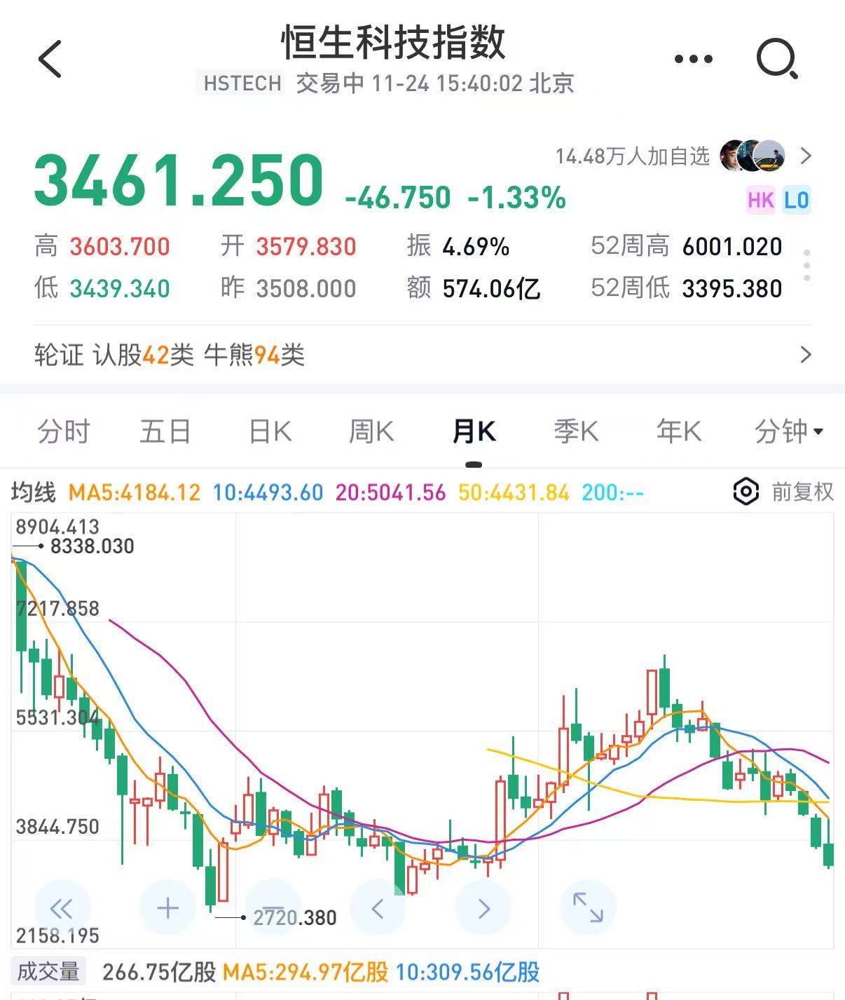

厚礼蟹！恒生科技从去年10月份阶段高点一路下跌，持续了整整一年多，到目前为止没有任何趋势改变的迹象，亏麻了。
随着AI产业的发展，阿里巴巴等大模型以及云业务发展不错，股价被重新定价（ 往下:-( ），跟美股相关方向的股票差距太大。
到目前为止，很多中概股都跌倒了底部区域，甚至是新低。

原因肯定是多方面的，不多赘述，我们的原则要远离中概。

但是恒生科技跌到现在我们需要重新的关注下，指数快跌到22-24年的底部整理区间，目前可能还有10%-20%的下跌空间。
目前在逐步的试探性买入，但是都被埋了。。。后续还会持续试探 :-(

